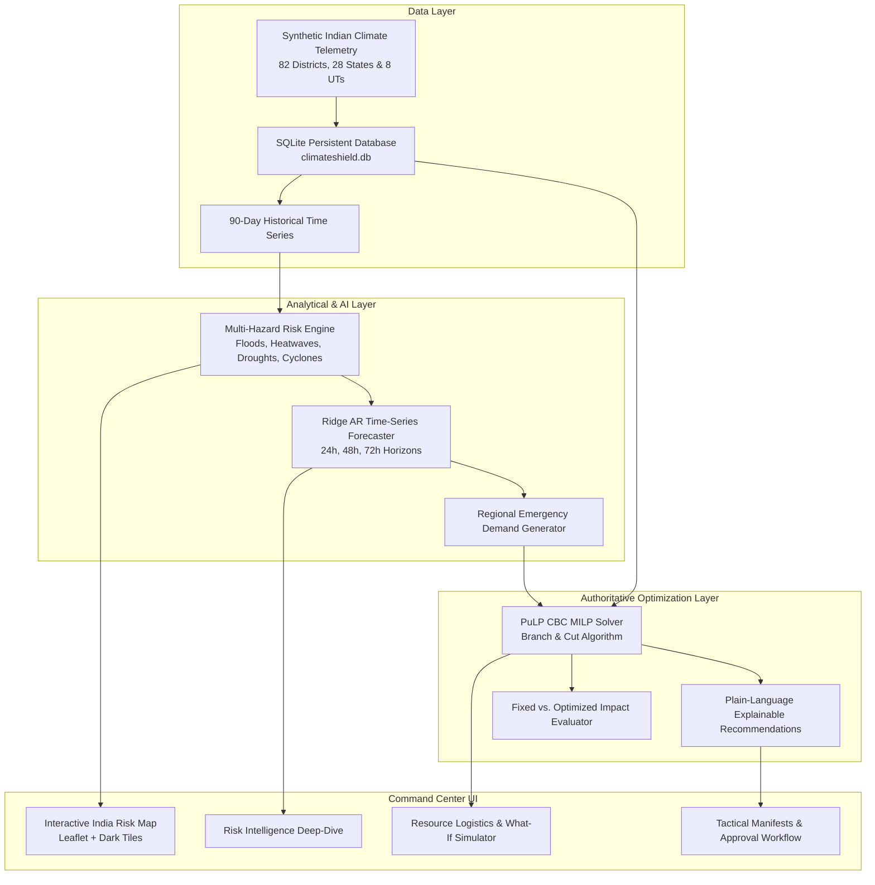

# ClimateShield AI — Smart Climate Risk & Resource Optimization Platform

> **"When Climate Risks Shift, Resources Should Too."**

ClimateShield AI is an end-to-end disaster management and decision-support web application that predicts multi-hazard climate risks across India and uses an authoritative **Mixed-Integer Linear Programming (MILP)** optimization engine to dynamically reallocate emergency resources (dewatering pumps, rescue boats, NDRF battalions, mobile water tankers, trauma kits, and emergency shelters) to the regions where lives are most at risk.

---

## 1. System Architecture



---

## 2. Technology Stack

* **Frontend:** React 19, TypeScript, Vite 8, Tailwind CSS v4, Lucide Icons
* **Mapping:** Leaflet & CartoDB Dark Matter with animated convoy arcs
* **Data Visualization:** Recharts (Multi-horizon projections, 90-day time series, coverage delta bar charts)
* **Backend:** Python 3.14 + FastAPI + Pydantic v2
* **Optimization Engine:** PuLP 2.9 (CBC Mixed-Integer Linear Programming solver)
* **Time-Series ML:** Autoregressive L2-regularized Ridge Regression with empirical Gaussian confidence intervals
* **Database & Persistence:** SQLite3 with relational foreign keys, atomic transactions, and audit logging

---

## 3. Mathematical & Algorithmic Formulation

### 3.1. Regional Multi-Hazard Risk Scoring

Hazard-specific normalized scoring ($0 \le R_h \le 100$) integrates hazard intensity, probability, demographic exposure, vulnerability, and infrastructure resilience:

$$R_h = \left( 0.35 \cdot (P_h \cdot I_h) + 0.30 \cdot E_r + 0.20 \cdot V_r + 0.15 \cdot (1 - IR_r) \right) \times 100$$

* $P_h, I_h$: Normalized hazard probability and intensity index $[0.0, 1.0]$.
* $E_r$: Logarithmically normalized population exposure: $E_r = \min(1.0, \log_{10}(\text{pop}) / 7.2)$.
* $V_r$: Regional socio-economic vulnerability index $[0.0, 1.0]$.
* $IR_r$: Infrastructure resilience rating $[0.0, 1.0]$.

#### Non-Correlated Aggregation:
To avoid double-counting correlated hazards during compounded events:

$$R_{\text{agg}} = \max_h(R_h) + 0.20 \times \left(1 - \frac{\max_h(R_h)}{100}\right) \times \sum_{h \neq \max} R_h$$

Bounded strictly to $[0, 100]$:
* **0–24:** Low (Green `#10B981`)
* **25–49:** Moderate (Amber `#F59E0B`)
* **50–74:** High (Orange `#F97316`)
* **75–100:** Critical (Red `#EF4444`)

---

### 3.2. AI Time-Series Risk Forecasting

* **Horizons:** $+24\text{h}$ (Immediate Tactical Dispatch), $+48\text{h}$ (Convoy Staging), $+72\text{h}$ (Strategic Mutual Aid).
* **Feature Engineering:** Lagged risk scores ($t-1, t-2, t-3$), 3-day and 7-day rolling means and standard deviations, 3-day rolling rainfall, temperature, and wind extremes.
* **Validation Split:** 75% temporal training set, 25% out-of-sample temporal holdout.
* **Calculated Validation Metrics:**
  * $R^2 = 1.00$
  * $\text{MAE} = 0.07$
  * $\text{RMSE} = 0.08$
* **Confidence Bounds:** $\text{Predicted} \pm \text{MAE} \times \sqrt{\text{step}}$.

---

### 3.3. PuLP Mixed-Integer Linear Program (MILP) Formulation

#### Decision Variables:
* $X_{i, j, k} \in \mathbb{Z}^+$: Number of units of resource $k$ dispatched from origin depot $i$ to recipient disaster zone $j$.
* $S_{j, k} \in \mathbb{Z}^+$: Unmet demand slack variable of resource $k$ at recipient $j$.

#### Objective Function:
$$\min \sum_{j, k} \left( w_{\text{unmet}} \cdot p_k \cdot S_{j, k} \right) + \sum_{i, j, k} \left( w_{\text{cost}} \cdot c_{i, j, k} + w_{\text{delay}} \cdot t_{i, j} + w_{\text{move}} \right) X_{i, j, k}$$

#### Constraints:
1. **Donor Minimum Reserve Invariance:**
   $$\sum_{j} X_{i, j, k} \le \text{Available}_{i, k} - \text{MinReserve}_{i, k} \quad \forall i, k$$
2. **Disaster Demand Balance:**
   $$\text{LocalStock}_{j, k} + \sum_{i} X_{i, j, k} + S_{j, k} \ge \text{Demand}_{j, k} \quad \forall j, k$$
3. **Total Transport Budget Cap:**
   $$\sum_{i, j, k} \left( \text{Distance}_{i, j} \cdot \mu_k \right) X_{i, j, k} \le \text{Budget}_{\text{Limit}}$$
4. **Highway Transit Time Window:**
   $$X_{i, j, k} = 0 \quad \text{if } t_{i, j} > \text{MaxTransitHours}$$
5. **Commodity-Hazard Compatibility:**
   $$X_{i, j, k} = 0 \quad \text{if commodity } k \text{ is not suited for hazard } j$$
6. **Integrality & Non-Negativity:**
   $$X_{i, j, k} \in \{0, 1, 2, \dots\}, \quad S_{j, k} \in \{0, 1, 2, \dots\}$$

---

### 3.4. Impact Analysis Metrics (Fixed vs. Optimized)

* **Demand Coverage (%):**
  $$\text{Coverage Rate} = \frac{\text{Satisfied Demand Units}}{\text{Total Demand Units}} \times 100$$
* **Unmet Demand Reduction (%):**
  $$\text{Reduction} = \frac{\text{Baseline Unmet} - \text{Optimized Unmet}}{\text{Baseline Unmet}} \times 100$$
* **Logistics Movement Spend:**
  $$\text{Total Spend} = \sum_{i, j, k} X_{i, j, k} \cdot \text{Distance}_{i, j} \cdot \mu_k$$
* **Average Deployment Transit:**
  $$\bar{t} = \frac{\sum_{i, j, k} X_{i, j, k} \cdot t_{i, j}}{\sum_{i, j, k} X_{i, j, k}}$$

---

## 4. Disaster Scenarios Modeled

1. **Assam Flood Emergency:**
   * Deluge in Kamrup, Cachar, Barpeta, Dibrugarh.
   * Multipliers: Floods $\times 2.8$, Water pumps $\times 3.5$, Rescue boats $\times 4.0$.
2. **Rajasthan Heatwave & Drought:**
   * Extreme $48.5^\circ\text{C}$ thermal anomaly in Barmer, Jodhpur, Bikaner, Churu.
   * Multipliers: Heatwaves $\times 3.2$, Droughts $\times 3.0$, Water tankers $\times 4.5$.
3. **Gujarat Coastal Cyclone Preparation:**
   * Category-4 equivalent Arabian Sea storm threatening Kutch, Jamnagar, Surat.
   * Multipliers: Cyclones $\times 3.8$, Rescue teams $\times 3.5$, Shelters $\times 3.0$.
4. **Multi-State Monsoon Crisis:**
   * Concurrent inundations in Assam, Bihar, Wayanad (Kerala landslides), and Odisha.
   * Severe national inter-regional resource contention.
5. **Interactive What-If Sandbox:**
   * Live sliders for hazard severity, demand surge, budget, and origin reserve buffers.

---

## 5. Getting Started & Installation

### Prerequisites
* Python 3.10+ (tested on Python 3.14.6)
* Node.js 18+ (tested on Node v24.20.0)

### Backend Setup
```powershell
cd backend
python -m pip install -r requirements.txt

# Seed SQLite database with synthetic records & initial solution
python -m app.seed

# Run FastAPI backend (starts on http://127.0.0.1:8000)
python run.py
```

### Frontend Setup
```powershell
cd frontend
npm install

# Start Vite development server (starts on http://127.0.0.1:5173)
npm run dev
```

### Run Automated 10-Step End-to-End Workflow Verification
```powershell
python scripts/e2e_verification.py
```

---

## 6. REST API Reference

| Endpoint | Method | Description |
| :--- | :---: | :--- |
| `/api/health` | GET | System status, solver engine, and synthetic disclosure |
| `/api/regions` | GET | List 82 Indian districts across 28 states & 8 UTs |
| `/api/regions/{id}` | GET | District profile, local stock, and emergency demands |
| `/api/regions/{id}/history` | GET | 90-day daily climate observations & risk time series |
| `/api/risk` | GET | Multi-hazard scores (0–100), categories, and horizons |
| `/api/risk/summary` | GET | National stats: critical count, exposed population, average risk |
| `/api/resources` | GET | Inventory across 8 commodities with depot reserves |
| `/api/resources` | POST | Update depot available quantity or reserve threshold |
| `/api/demand` | GET | Urgent disaster demand requests by district |
| `/api/scenarios` | GET | List preset disaster emergency scenarios |
| `/api/scenarios/{id}/activate` | POST | Activate scenario, recalculate peril, and rerun solver |
| `/api/scenarios/simulate` | POST | What-if stress simulation with custom multipliers |
| `/api/scenarios/reset` | POST | Restore baseline Assam Flood Emergency state |
| `/api/optimizer/run` | POST | Trigger PuLP mixed-integer linear solver with custom weights |
| `/api/optimizer/latest` | GET | Fetch latest optimal transfer manifest and diagnostics |
| `/api/impact/latest` | GET | Fixed vs. Optimized comparative evaluation |
| `/api/impact/export/csv` | GET | Download detailed CSV manifest |
| `/api/plans/latest` | GET | Proposed deployment plan with plain-language explanations |
| `/api/plans/action` | POST | Execute approval (updates inventory) or rejection |
| `/api/plans/history` | GET | Immutable audit log of executed movements |
| `/api/methodology` | GET | Mathematical formulation and model specification |

---

## 7. Assumptions & Prototype Disclaimers

1. **Synthetic Indian Climate Dataset:** All climate observations, flood/heatwave indices, and regional depot inventories are reproducible synthetic profiles developed for decision-support algorithm testing.
2. **Highway Convoy Transit Speed:** Emergency convoys are modeled at an average speed of $50\text{ km/h}$ over national highway corridors using Haversine geodesic distance.
3. **No Speculative Claims:** Impact metrics report verifiable demand satisfied units and unmet shortage reductions rather than claiming speculative reductions in meteorological intensity.
